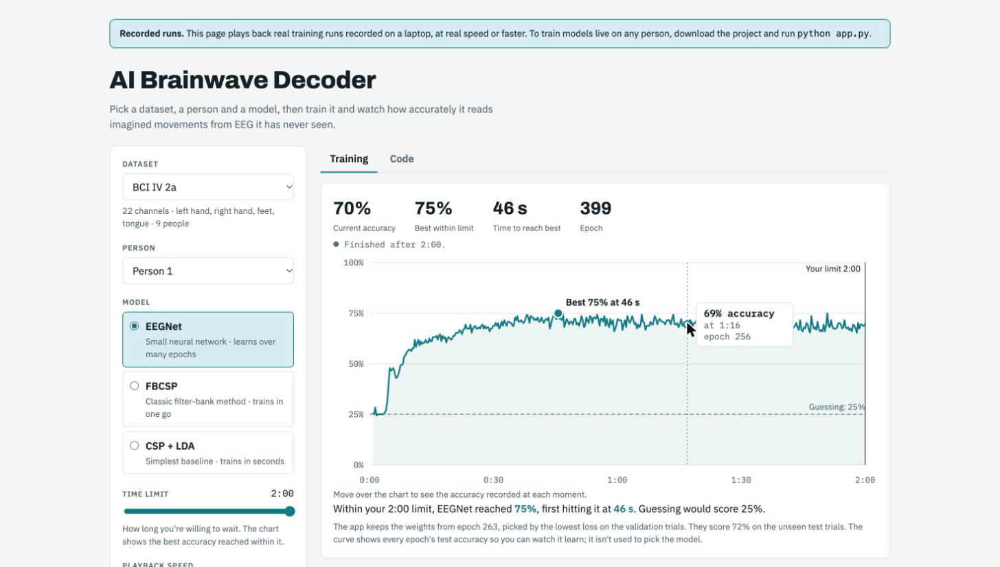

# AI Brainwave Decoder

[](https://github.com/franciszekmarmul-png/ai-brainwave-decoder/actions/workflows/tests.yml)

Train AI models to read imagined movements from real brain recordings (EEG), and watch them learn.

Pick a dataset, a person and a model, set how long you're willing to wait, and press **Train**. The app trains the model on your computer and charts its accuracy on brainwaves it has never seen, second by second. It shows the best accuracy it reached within your time limit and how long it took to get there. The **Code** tab shows the command running, the training log and the real Python behind it, with the line that's running highlighted.

**Try it without installing:** [recorded runs on GitHub Pages](https://franciszekmarmul-png.github.io/ai-brainwave-decoder/) play back real training runs recorded on a laptop.



## Run it yourself

You need Python 3.11 or newer.

```bash
git clone https://github.com/franciszekmarmul-png/ai-brainwave-decoder.git
cd ai-brainwave-decoder
python3 -m venv .venv
.venv/bin/pip install -r requirements.lock
.venv/bin/python app.py
```

The page opens at <http://127.0.0.1:8000>. The first time you pick a dataset it downloads it (from a few MB to about 600 MB) and keeps it in `data/`.

## What's inside

**Datasets** (all public, loaded with [MOABB](https://moabb.neurotechx.com)):

| Dataset | Movements imagined | Channels | People | Trials per person |
|---|---|---|---|---|
| BCI Competition IV 2a | left hand, right hand, feet, tongue | 22 | 9 | 576 |
| BCI Competition IV 2b | left hand, right hand | 3 | 9 | about 720 |
| PhysioNet Motor Imagery | left hand, right hand | 64 | first 10 | 45 |

Every trial is band-pass filtered to 4–40 Hz, cut to 0.5–2.5 s after the cue and resampled to 128 Hz.

PhysioNet has only 45 trials per person, so its test accuracy comes from 11–12 trials and jumps around a lot.

**Models:**

- **EEGNet** ([Lawhern et al., 2018](https://doi.org/10.1088/1741-2552/aace8c)): a compact convolutional neural network with about 1,700 weights. It learns over many epochs, and the app keeps the weights with the lowest loss on the validation trials.
- **FBCSP:** the classic method EEGNet was compared against. It splits the EEG into 9 frequency bands, learns spatial filters in each, and uses a regularized logistic regression.
- **CSP + LDA:** the simplest standard baseline.

**How accuracy is measured:** each person's trials are split in recording order into four blocks. The model learns from two blocks, uses one to check its progress and is tested on the last, which it never sees during training. Guessing scores 25% on 2a and 50% on the two-movement datasets.

## The research behind it

The app grew out of a replication of the EEGNet paper's motor-imagery results on BCI IV 2a, plus a follow-up experiment of our own. Full write-up: [results/report.md](results/report.md).

| | EEGNet | FBCSP | Paper (EEGNet / FBCSP) |
|---|---|---|---|
| Trained and tested on the same person | 69.3% | 70.0% | ≈68% / ≈68% |
| Tested on a new person | 36.5% | 36.6% | ≈39% / ≈32% |

The follow-up experiment fine-tuned a model trained on 8 other people using a few trials from a new person. Accuracy rose from 45% with no calibration to 54% with 96 trials.

To rerun the experiments (several hours on a laptop CPU):

```bash
bash run_experiments.sh
.venv/bin/python -m src.plots --results results
```

## Project layout

```
app.py              starts the app
src/live.py         trains one model on one person and reports each step
src/server.py       the local web server behind the page
src/record.py       records runs for the hosted replay page
src/data.py         downloads and preprocesses the datasets
src/eegnet.py       EEGNet in PyTorch
src/train.py        the training loop
src/baselines.py    FBCSP and CSP + LDA
src/splits.py       train, validation and test splits
src/evaluate.py     the replication experiments
src/plots.py        charts for the report
web/                the page (HTML, CSS, JavaScript) and recorded runs
results/            replication results, charts and report
docs/               design notes
tests/              pytest tests
```

Run the tests with `.venv/bin/pytest -m "not data"`. Leave out `-m "not data"` to also run the checks against the real downloaded data.

## Sources

**Data**

- BCI Competition IV, dataset 2a: Brunner, C., Leeb, R., Müller-Putz, G. R., Schlögl, A. and Pfurtscheller, G. (2008), Graz University of Technology. <https://www.bbci.de/competition/iv/>
- BCI Competition IV, dataset 2b: Leeb, R., Brunner, C., Müller-Putz, G. R., Schlögl, A. and Pfurtscheller, G. (2008), Graz University of Technology. <https://www.bbci.de/competition/iv/>
- PhysioNet EEG Motor Movement/Imagery Dataset: Schalk, G. et al. (2004). BCI2000: a general-purpose brain-computer interface system. *IEEE Transactions on Biomedical Engineering*, 51(6). Shared through PhysioNet: Goldberger, A. L. et al. (2000), *Circulation*, 101(23). <https://physionet.org/content/eegmmidb/1.0.0/>

**Models**

- EEGNet: Lawhern, V. J. et al. (2018). EEGNet: a compact convolutional neural network for EEG-based brain–computer interfaces. *Journal of Neural Engineering*, 15(5). <https://doi.org/10.1088/1741-2552/aace8c>
- FBCSP: Ang, K. K., Chin, Z. Y., Zhang, H. and Guan, C. (2008). Filter Bank Common Spatial Pattern (FBCSP) in brain-computer interface. *IJCNN 2008*. <https://doi.org/10.1109/IJCNN.2008.4634130>
- CSP + LDA: Ramoser, H., Müller-Gerking, J. and Pfurtscheller, G. (2000). Optimal spatial filtering of single trial EEG during imagined hand movement. *IEEE Transactions on Rehabilitation Engineering*, 8(4). <https://doi.org/10.1109/86.895946>

**Software**

- [MOABB](https://github.com/NeuroTechX/moabb) (Jayaram, V. and Barachant, A., 2018, *Journal of Neural Engineering*, 15(6)) downloads and epochs the datasets.
- [MNE-Python](https://mne.tools/), [scikit-learn](https://scikit-learn.org/) and [PyTorch](https://pytorch.org/).

## Credits

Built for The Knowledge Society (TKS) by Franciszek Marmul.

## License

The code is MIT, see [LICENSE](LICENSE). The datasets are not included in this repository; each keeps its own licence and is downloaded from its source on first run.
