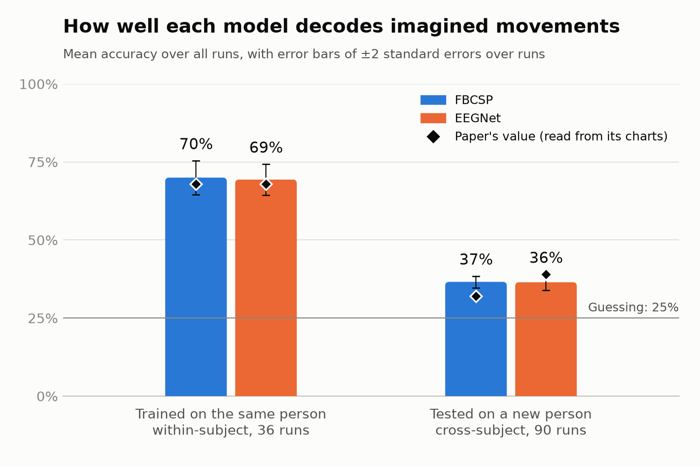
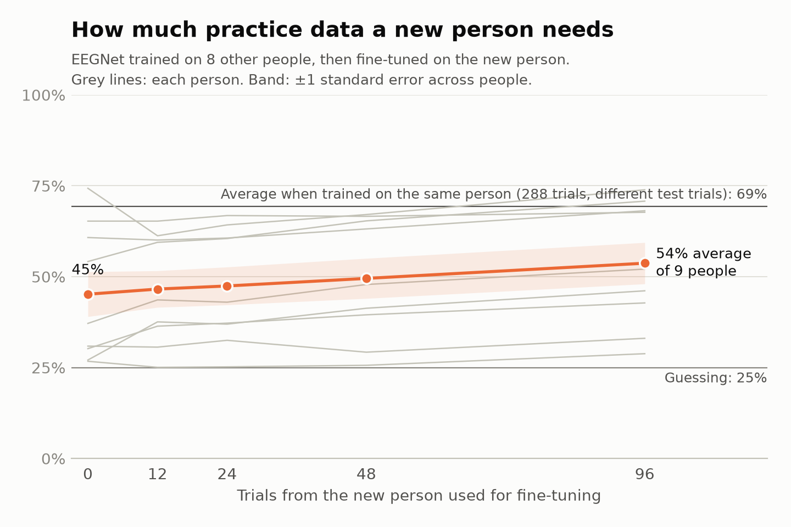
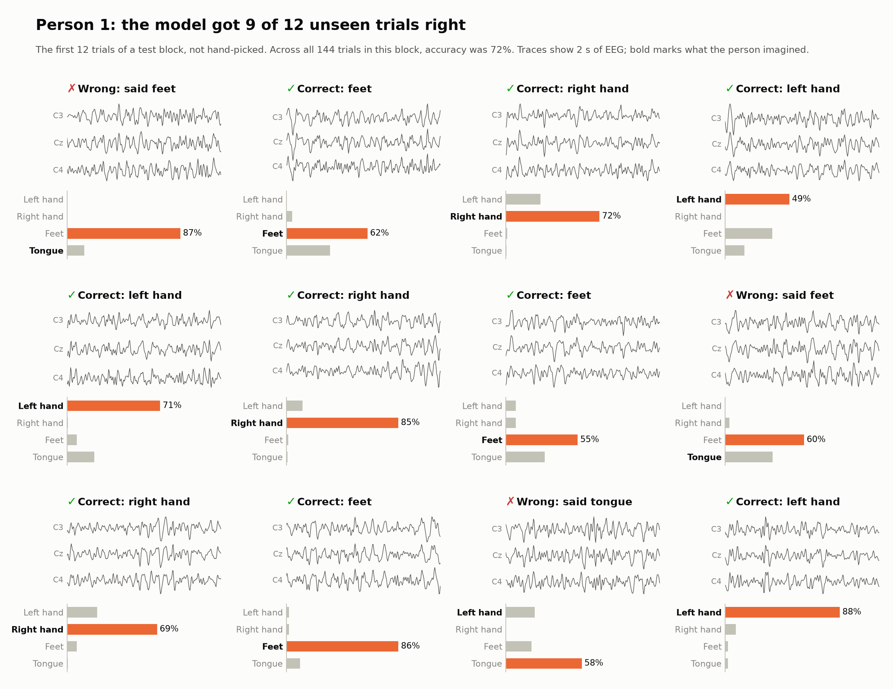

# Decoding imagined movements from EEG: an EEGNet replication

TKS replicate project, November 2026.

## Goal

We built and trained our own neural network to decode imagined movements from
real brain recordings. It reproduces the motor-imagery result from the EEGNet
paper (Lawhern et al., 2018), and we added one question of our own: how much
data from a new person does it take to make a model trained on other people
work well for them?

## Data and method

- **Data:** BCI Competition IV 2a, downloaded through MOABB (`BNCI2014_001`).
  9 people, 22 EEG channels, 4 imagined movements (left hand, right hand, feet,
  tongue), 576 trials per person over 2 sessions. Guessing scores 25%.
- **Preprocessing (from the paper):** 4–40 Hz band-pass, 0.5–2.5 s after the
  cue, resampled to 128 Hz, giving 256 samples per trial.
- **Models:**
  - EEGNet-8,2 in PyTorch, with 1,716 trainable parameters, matching the
    paper's Table 3.
  - FBCSP, the paper's baseline: 9 bands, 2 CSP pairs per band, elastic-net
    logistic regression.
  - CSP + LDA, used only as a check that the data pipeline works.
- **Training:** Adam with default settings, cross-entropy loss, up to 500
  epochs, keeping the weights with the lowest validation loss, batch size 32,
  and the paper's max-norm limits and dropout. Everything ran on the CPU.
- **Within-subject:** each person's trials are split into 4 blocks; each
  model trains on 2, validates on 1 and tests on 1. That gives 4 folds × 9
  people = 36 runs per model.
- **Cross-subject:** for each test person, train on 5 other people, validate
  on 3, and test on the test person's second session. This is repeated 10
  times per person, for 90 runs per model.
- **Test data is never used** for training, early stopping, standardization or
  choosing settings. Every run's seed and settings are saved next to its CSV.

## Replication results



| Evaluation | Model | Our mean | ±1 SE over runs | ±1 SE over people | Range over people | Paper (approx.) |
|---|---|---|---|---|---|---|
| Within-subject | EEGNet-8,2 | **69.3%** | 2.5 (36 runs) | 5.0 | 48.6–87.7% | ≈68% |
| Within-subject | FBCSP | **70.0%** | 2.7 (36 runs) | 5.4 | 48.8–86.5% | ≈68% |
| Within-subject | CSP + LDA (check) | 57.5% | 2.6 (36 runs) | 5.1 | 37.0–75.0% | not in paper |
| Cross-subject | EEGNet-8,2 | **36.5%** | 1.3 (90 runs) | 3.4 | 25.6–54.3% | ≈39% |
| Cross-subject | FBCSP | **36.6%** | 0.9 (90 runs) | 2.7 | 27.6–53.3% | ≈32% |

The paper's values are approximate readings off its Figures 3 and 5. The
paper's text gives no exact numbers for this dataset.

**Head-to-head comparison per person** (EEGNet minus FBCSP, averaged over each
person's runs, ±1 standard error across the 9 people):

- Within-subject: −0.6 ± 1.3 points.
- Cross-subject: −0.1 ± 1.9 points.

In both settings the two models are level.

### Success criteria

1. **EEGNet clearly beats guessing on every evaluation. Met.** It scores 69.3%
   within-subject and 36.5% cross-subject, against 25% for guessing. In the
   cross-subject test, 2 of the 9 people (persons 2 and 5) score close to
   chance.
2. **The same pattern as the paper. Partly met.**
   - Within-subject, EEGNet and FBCSP are level, as in the paper, and both
     sit close to the paper's value.
   - Cross-subject, the paper has EEGNet slightly ahead of FBCSP. We find
     them tied, because our FBCSP scored higher than the paper's (36.6% vs
     ≈32%) and our EEGNet a little lower (36.5% vs ≈39%).
   - A reviewer check found that the FBCSP cross-subject number depends on one
     setting: using one regularization value for all 4 one-vs-rest
     classifiers, as we did, versus choosing it per classifier moved accuracy
     by about 9 points in a 9-fold sensitivity run. So that gap is uncertain.
3. **Compared with the paper's Figures 3 and 5. Met**, using approximate
   readings, shown above and as markers on the chart.
4. **Charts, demo and write-up ready. Met:** `replication.png`,
   `calibration.png`, `demo.png` and this report.

## Our question: how much calibration data does a new person need?



**Method:**

1. For each person, train EEGNet on the other 8 people's first session.
2. Fine-tune it on 0, 12, 24, 48 or 96 trials from the new person's first
   session, with equal trials per class.
3. Test on the new person's second session.

Each size is repeated with 5 random trial selections, and the smaller
selections are subsets of the larger ones. That gives 189 runs.

| Calibration trials from the new person | 0 | 12 | 24 | 48 | 96 |
|---|---|---|---|---|---|
| Accuracy (mean of 9 people) | 45.2% | 46.6% | 47.4% | 49.5% | 53.7% |
| ±1 SE across people | 6.2 | 5.0 | 5.2 | 5.5 | 5.7 |

**Findings:**

- **Accuracy rises steadily with more calibration data, gaining 8.5 points by
  96 trials.** That many trials takes roughly 10 minutes to record. At 96
  trials the model is still well below the ≈69% from training on that person
  alone. That comparison is not exactly equal: the within-subject models used
  288 of that person's trials and were tested on different trials.
- **People differ a lot.**

  | Person | 0 trials | 96 trials | Change |
  |---|---|---|---|
  | 6 | 27% | 46% | +19 points |
  | 9 | 54% | 71% | +17 points |
  | 7 | 37% | 52% | +15 points |
  | 5 | 27% | 29% | stays near chance |
  | 2 | 31% | 33% | stays near chance |

- **A few trials can hurt.** Person 3 starts at 74% with no calibration, drops
  to 61% after 12 trials, and only recovers (74%) at 96 trials. A few trials
  with a fixed fine-tuning schedule can pull a good model off course.
- **The 0-trial point (45%) is higher than the cross-subject result (36.5%).**
  It is a different setup: the base model trains on 8 people, not 5, and uses
  10% of their trials for validation instead of 3 separate people. The two
  numbers should not be compared directly.

**Related work:** calibrating a model trained on other people is an
established idea. Zhang, Robinson, Lee and Guan (2021, *Neural Networks* 136,
1–10, doi:10.1016/j.neunet.2020.12.013) compare five ways of fine-tuning a
pretrained CNN on a target person for two-class motor imagery. Wei, Ortega and
Faisal (2021, IEEE/EMBS NER, arXiv:2103.05351) study transfer between people
on this same dataset, using a network with person-specific layers rather than
fine-tuning. We checked these citations against their abstracts and catalogue
records, not their full text. Our experiment is a project extension that
measures this on our own replication, not a new scientific claim.

## Demo



The demo shows 12 test trials from person 1 (fold 0, within-subject). For each
trial it shows:

- the EEG traces at C3, Cz and C4, the electrodes over the motor areas;
- the true movement;
- the model's probability for each of the 4 movements.

The model is retrained on the CPU with the same seed as the saved run.

These are the first 12 trials of the test block, not hand-picked. The model
got 9 of them right, and 72% across all 144 trials in that block, matching
the saved run (71.5%).

## Differences from the paper and decisions we made

These are choices the paper or our spec left open, or places where we know we
differ:

- **Input scaling:** each channel is z-scored using the mean and standard
  deviation of the training trials only. The paper follows Schirrmeister et
  al. (2017), whose exact input standardization we did not confirm, so this
  may differ from the original.
- **Batch size:** 32. The paper doesn't state one.
- **Weight initialization:** PyTorch's defaults, not Keras's Glorot uniform
  used in the original code.
- **Resampling:** MOABB band-pass filters the continuous signal, then
  resamples each epoch separately.
- **FBCSP:**
  - bands are filtered per trial with MNE;
  - CSP uses `reg="ledoit_wolf"` and `component_order="alternate"`;
  - the elastic-net regularization C is chosen from 10⁻³…10² (6 values) on
    validation accuracy, with one value shared by the 4 one-vs-rest
    classifiers.

  This affects the cross-subject FBCSP number (see above).
- **Within-subject blocks:** 4 consecutive blocks of 144 trials. Fold k tests
  on block k, validates on block (k+1) mod 4, and trains on the other two.
  Because each person has 288 trials per session, these blocks mix the two
  recording sessions, which the paper doesn't define for this dataset.
- **Cross-subject training data:** uses only the first session of the
  training and validation people. Testing uses the test person's second
  session.
- **Calibration base models:** trained on the first session of the other 8
  people, with a stratified 10% of trials per person held out for
  validation. There is one base model per test person, so the 5 selections
  share the same starting point.
- **Fine-tuning:**
  - all layers update for a fixed 50 epochs at learning rate 1e-4, with no
    early stopping, because there is no held-out data from the new person;
  - with batch size 32, this gives a different number of update steps per
    size (50, 50, 100 and 150 steps for 12, 24, 48 and 96 trials);
  - BatchNorm statistics also shift toward the new person's few trials;
  - these settings were fixed before seeing any results and not tuned
    afterwards.
- **Paper values:** approximate readings from figures.
- **Hardware:** CPU only, single-threaded workers in parallel.

## Error bars and limits

- **Error bars:** the replication chart shows ±2 standard errors over runs. The
  calibration chart shows ±1 standard error across people. The tables above
  give both kinds where they differ.
- **Small sample:** with only 9 people and a wide spread between them, small
  differences between models (a point or two) are not meaningful.
- **Offline data only:** the data is offline imagined movement recorded in a
  lab, so these numbers do not show how a live brain-computer interface would
  perform.
- **Best epochs near the cap:** many within-subject EEGNet runs (median 441)
  and almost all calibration base models (median 487) reached their lowest
  validation loss near the 500-epoch cap. Longer training might help slightly.
  Cross-subject runs peaked early (median epoch 11), which fits a model that
  quickly overfits the training people.

## How to reproduce

```bash
python -m venv .venv && .venv/bin/pip install -r requirements.lock
./run_experiments.sh          # all experiments; resumable
.venv/bin/python -m src.plots --results results --demo-subject 1
.venv/bin/pytest
```
